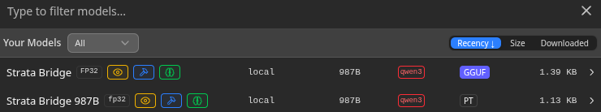
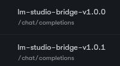
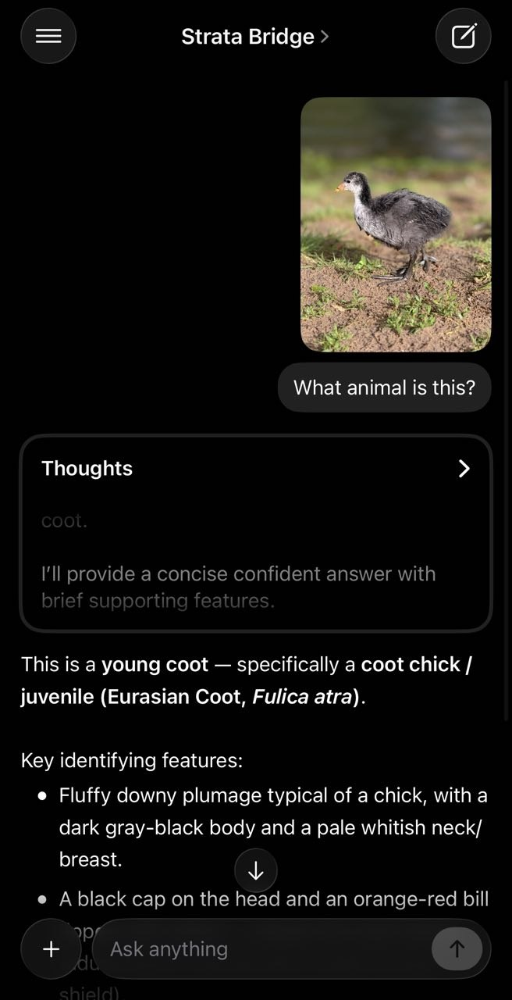

# Screenshots

How the bridge looks in the LM Studio and Strata GUIs. Each image is described below it.

## LM Studio model picker

The LM Studio "Your Models" picker showing both bridge routes as genuine loaded
instances: **Strata Bridge** (GGUF) and **Strata Bridge 987B** (PT). Both carry the
metadata badges the bridge advertises — arch `qwen3`, params `987B`, quant `FP32`, and
the vision / tool-use / reasoning icons — proving the fake model indexes like a real one.

## LM Studio runtime selections

LM Studio's "Runtime Selections" panel: the GGUF route resolves to the
`strata-linux-x86_64-vulkan-avx2` engine (v1.0.0) and the PT route to
`strata-linux-x86_64-avx2` (v1.0.0). Both manifest names are full-pattern so LM Studio
recognizes them as selectable engines (prettified to "Strata (Linux)" in the picker).

## Strata GUI — reported client

The Strata GUI activity feed showing the bridge as the reported client: both routes
arrive as `lm-studio-bridge-v1.0.0` hitting `/chat/completions`.
This is the engine process's spawn-time `argv[0]` (set by the `strata-launch` wrapper), so
Strata sees the bridge — not a generic `node` — as the caller.

## Phone app over LM Link

The **Locally** app on iPhone chatting with the linked **Strata Bridge** instance over
**LM Link**. The phone selected the bridge model and sent an image ("What animal is this?");
the bridge served it through Strata and returned a real **vision** answer (identifying a
young coot / *Fulica atra*) with a **Thoughts** reasoning block. This proves the bridge's
capabilities — vision + reasoning — reach a remote device over LM Link, not just the local
GUI.